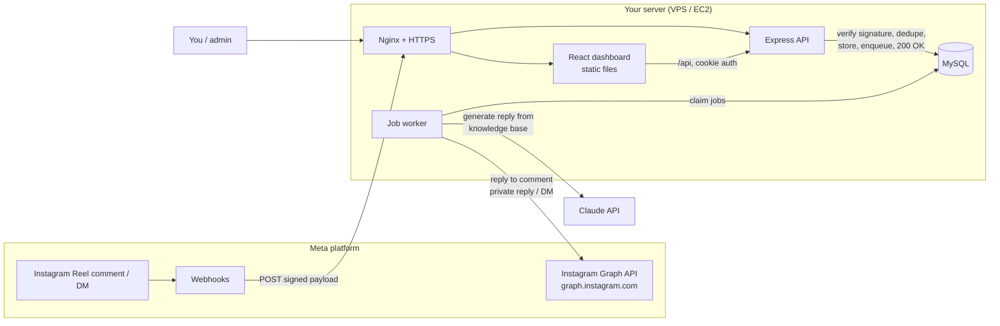
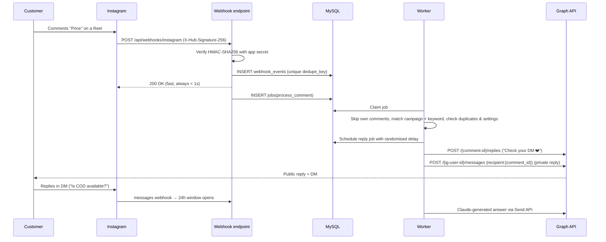
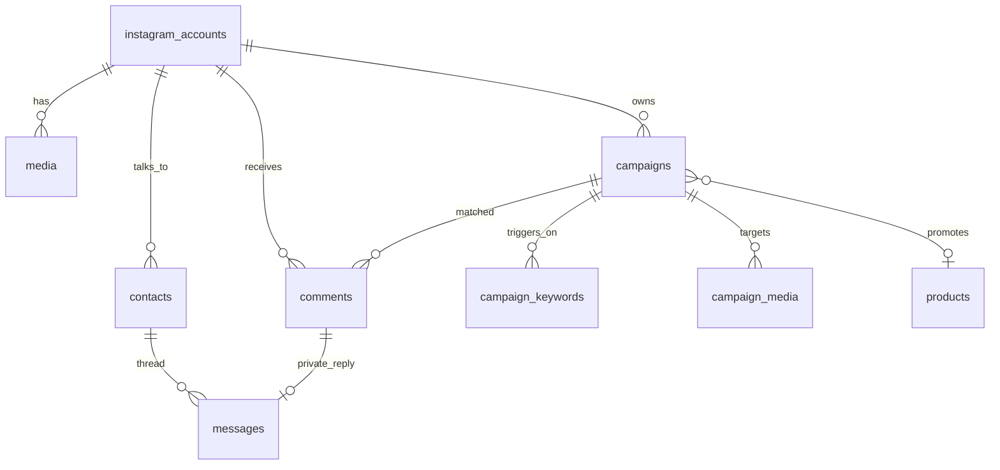

# Architecture

A self-hosted platform that watches comments on your Instagram Reels, replies publicly,
sends one private DM per eligible comment, and lets Claude answer follow-up DMs from your
business knowledge base. Everything is managed from your own dashboard.

---

## 1. Technology decisions

### Backend: **Node.js + Express** (chosen over Spring Boot)

| Concern | Node.js + Express | Spring Boot |
|---|---|---|
| Language | **JavaScript everywhere**: the React dashboard and the API share one language and one toolchain | Java on the backend, JS on the frontend |
| Webhook workload | Event loop suits many short I/O-bound requests (receive → store → enqueue → 200 OK) | Also fine, but heavier for this shape of work |
| Claude SDK | Official `@anthropic-ai/sdk` (TypeScript/JS) | Official Java SDK exists too |
| Server size | Runs comfortably on a **1 GB VPS** (~80–120 MB RAM) | JVM typically wants 512 MB–1 GB on its own |
| Iteration speed | No compile step, `node --watch` reloads instantly | Slower build/restart cycle |
| Graph API | Plain HTTPS + JSON, which `fetch` handles natively | Needs RestTemplate/WebClient boilerplate |

Spring Boot is excellent for large teams and complex domains. This is a one-owner,
I/O-heavy integration app where small size, low cost and a single language matter more,
so **Express 5** is the better fit.

### Other choices

| Layer | Choice | Why |
|---|---|---|
| Frontend | React 19 + Vite + Tailwind CSS v4 | Fast dev server, small bundle, utility-first styling for a polished UI |
| Database | MySQL 8 (as requested) via **Knex** | Versioned migrations, safe parameterised queries, no heavy ORM magic |
| Background jobs | **MySQL-backed job table** (`jobs`) | Durable retries, delays and dedupe **without Redis**, so there's one less service to run and back up. Workers claim jobs with `SELECT … FOR UPDATE SKIP LOCKED`. |
| Validation | Zod | One schema validates env vars and every request body |
| Logging | Pino (JSON) | Fast structured logs with secret redaction |
| Auth | bcrypt + JWT in an **httpOnly, SameSite=Strict cookie** | Tokens can't be read by injected JS, and the cookie isn't sent on cross-site requests |
| Process manager | PM2 or systemd (Phase 8) | Auto-restart, start on boot, log rotation |
| Reverse proxy | Nginx + Let's Encrypt (Phase 8) | HTTPS, which Meta webhooks require |

---

## 2. System overview



### Comment → reply → DM flow (Phases 3–4)



### Why "store, then 200, then process"
Meta retries webhooks that don't get a fast `200`, and turns off subscriptions that fail
repeatedly. Doing Graph API and Claude calls inside the webhook request would be slow and
fragile, so the request only verifies, stores and enqueues. The worker handles the slow
work with retries and backoff. The unique `dedupe_key` / `ig_comment_id` / `ig_message_id`
columns mean a retried webhook can never cause a second reply.

---

## 3. Meta API approach

We use the **Instagram API with Instagram Login** (`graph.instagram.com`), Meta's current
official path for Instagram professional accounts. It doesn't require a linked Facebook Page.

| Capability | Endpoint / mechanism | Permission (scope) |
|---|---|---|
| Account profile, media list | `GET /me`, `GET /{ig-user-id}/media` | `instagram_business_basic` |
| Read / reply / hide comments | `GET/POST /{comment-id}/replies` | `instagram_business_manage_comments` |
| Private reply to a comment | `POST /{ig-user-id}/messages` with `recipient: { comment_id }` | `instagram_business_manage_messages` |
| DMs (conversation) | `POST /{ig-user-id}/messages` with `recipient: { id: IGSID }` | `instagram_business_manage_messages` |
| Real-time events | Webhooks, fields `comments` and `messages` | — |

### Meta's rules, and how the platform follows them
Treat these as hard constraints. The exact numbers change, so check Meta's current docs at
each phase.

1. **One private reply per comment.** A comment can receive one private reply, and only
   within a limited time after it was posted (currently 7 days). We send it immediately
   after the public reply.
2. **No unsolicited follow-ups.** After the private reply, you can only message the person
   again if **they reply**. That opens the standard **24-hour messaging window**, which
   resets on each customer message. We track `contacts.last_inbound_at` and never send
   outside the window. A human reply after 24h needs the `HUMAN_AGENT` tag, which needs
   its own approval.
3. **Not every comment can get a DM.** Private replies can fail, for example when the
   user's privacy settings block it, the comment was deleted, or it's too old. We record
   `private_reply_status = failed | ineligible` honestly. We never retry endlessly, and we
   never use workarounds.
4. **Rate limits.** Meta enforces per-account call limits. The worker throttles, respects
   error codes and backs off exponentially on throttling errors.
5. **Avoid spam signals.** Use several public reply variants (`campaigns.public_replies`,
   one is picked at random) and a randomised delay (`reply_delay_min/max_seconds`). Use one
   automation per user per Reel.
6. **Ignore our own comments.** Our replies also trigger `comments` webhooks. The worker
   skips any comment authored by the connected account, which prevents infinite loops.
7. **App Review.** In **Development mode**, webhooks and API calls only work for people who
   have a role on your app (you and testers). To serve real customers, the app needs
   **Advanced Access** to the scopes above via **App Review** (screencast + privacy policy
   URL), plus **Business Verification** where Meta asks for it.
8. **Account setting.** The Instagram account must allow connected tools to access
   messages: Instagram app → Settings → Messages and story replies → Message controls →
   Connected tools → *Allow access to messages*.

We never use browser automation, password logins, scraping or unofficial APIs.

---

## 4. Security model

| Threat | Mitigation |
|---|---|
| Forged webhooks | HMAC-SHA256 of the **raw body** with the app secret, compared in constant time (Phase 3). `req.rawBody` is already captured in Phase 1. |
| Stolen DB dump | Instagram tokens are **AES-256-GCM encrypted** (`src/utils/crypto.js`), and the key lives only in `.env`. Passwords are bcrypt-hashed (cost 12). |
| Session theft / CSRF | JWT in an `httpOnly` + `SameSite=Strict` + `Secure` (prod) cookie |
| OAuth CSRF / account-swap | Random `state` nonce bound to a signed, 10-minute, path-scoped cookie and checked in constant time. The callback ignores everything until the state matches. |
| Token leaks via URLs | Graph calls never log URLs (tokens are query params). Media paging follows cursors, not Meta's token-bearing `next` links. Redirects back to the dashboard carry fixed codes only. |
| Brute-force login | 10 attempts / 15 min per IP, and the same response timing whether or not the email exists |
| Secrets in the browser | The frontend only ever calls same-origin `/api`. **No API keys exist in frontend code or env.** |
| Duplicate / replayed events | Unique keys on events, comments, messages and jobs |
| Bad input | Every request body is validated with Zod, and all queries are parameterised by Knex |
| Leaky logs | Pino redacts cookies, auth headers, tokens and passwords |
| Common web attacks | Helmet security headers, strict CORS (dashboard origin only), 1 MB body limit |

---

## 5. Folder structure

```
ig-automation-platform/
├── README.md                  ← setup & run instructions
├── docker-compose.yml         ← local MySQL 8 for development
├── docs/
│   └── ARCHITECTURE.md        ← this file
├── backend/                   ← Express API + worker
│   ├── .env.example
│   ├── knexfile.js            ← DB connection + migration config
│   ├── package.json
│   ├── scripts/
│   │   ├── create-admin.js    ← create the first dashboard login
│   │   ├── generate-secrets.js
│   │   └── simulate-webhook.js ← send a signed test comment (no Meta needed)
│   ├── src/
│   │   ├── server.js          ← entry: DB check, HTTP server, (worker), graceful shutdown
│   │   ├── app.js             ← Express app: security middleware, raw body capture, routes
│   │   ├── config/            ← env.js (Zod-validated env), logger.js
│   │   ├── db/
│   │   │   ├── knex.js
│   │   │   └── migrations/    ← full schema (all phases)
│   │   ├── middleware/        ← auth, validate, errorHandler
│   │   ├── routes/            ← one router per feature, mounted in routes/index.js
│   │   ├── controllers/       ← HTTP layer: parse request → call service → respond
│   │   ├── services/          ← business logic (auth; later meta, automation, ai, …)
│   │   ├── utils/             ← crypto (AES-GCM, HMAC helpers), HttpError
│   │   ├── integrations/      ← instagramGraph.js (Phase 2); claude.js (Phase 5)
│   │   └── jobs/              ← tokenRefresher.js, queue.js (MySQL queue), worker.js, handlers.js
│   └── tests/                 ← Vitest + Supertest
└── frontend/                  ← React dashboard
    ├── index.html
    ├── vite.config.js         ← dev proxy /api → :4000
    └── src/
        ├── main.jsx, App.jsx  ← router
        ├── index.css          ← Tailwind + design tokens
        ├── api/client.js      ← fetch wrapper (cookie auth, 401 handling)
        ├── context/           ← AuthContext
        ├── components/        ← Layout (sidebar), ProtectedRoute, shared UI
        └── pages/             ← Login, Dashboard, … (one per section)
```

---

## 6. Database schema (summary)

The whole schema is created in Phase 1 (`backend/src/db/migrations/20261113000001_initial_schema.js`).

| Table | Purpose | Phase |
|---|---|---|
| `admin_users` | Dashboard logins (bcrypt hashes) | 1 |
| `app_settings` | Key/JSON settings: automation toggles, reply delay, duplicate protection | 1 / 6 |
| `activity_logs` | Error log, Graph API failures, automation decisions | 1 / 7 |
| `instagram_accounts` | Connected professional account + **encrypted** long-lived token, expiry, webhook status | 2 |
| `media` | Cached Reels so a campaign can pick one | 2 / 4 |
| `webhook_events` | Every webhook received, deduplicated, with status + error (powers "failed webhook events") | 3 |
| `comments` | Each comment, matched campaign/keyword, public reply + private reply outcome | 3 / 4 |
| `campaigns`, `campaign_keywords`, `campaign_media` | Campaigns: keywords, target Reels, reply variants, DM text, product, on/off, priority | 4 |
| `business_profile`, `products`, `faqs` | Knowledge base the AI is allowed to use; it's the only source of prices and stock | 5 |
| `contacts` | One row per customer (IGSID), AI pause switch, 24h window timestamps | 5 / 7 |
| `messages` | Full DM history, including source (customer / private_reply / ai / manual) and AI token usage | 5 / 7 |
| `jobs` | Durable queue: delays, retries with backoff, dedupe | 3+ |



---

## 7. Prerequisites checklist

**Accounts**
- [ ] Instagram account switched to **Professional** (Business or Creator): Instagram app → Settings → Account type and tools
- [ ] **Meta Developer account**: <https://developers.facebook.com> (log in with Facebook and verify it)
- [ ] **Anthropic account + API key**: <https://platform.claude.com> (needed in Phase 5)
- [ ] A **privacy policy URL** for your business (Meta requires one for App Review); a simple page on your site is enough
- [ ] A **domain name** for HTTPS in production (Phase 8), e.g. `automation.yourshop.in`

**Local machine**
- [ ] Node.js **20+** (`node -v`)
- [ ] Git
- [ ] Docker Desktop (easiest way to run MySQL locally), **or** a local MySQL 8 install
- [ ] A tunnel tool for testing webhooks locally in Phase 3: **ngrok** or **cloudflared**

**Server (Phase 8)**
- [ ] Ubuntu 22.04/24.04 VPS or AWS EC2 (t3.small or a 1–2 GB VPS is plenty)
